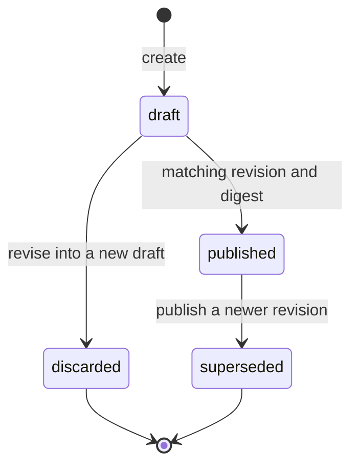
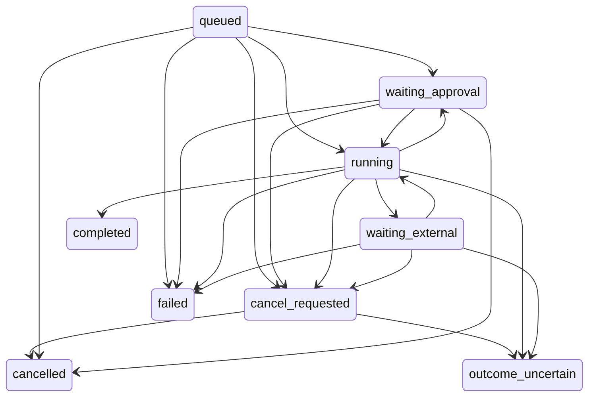
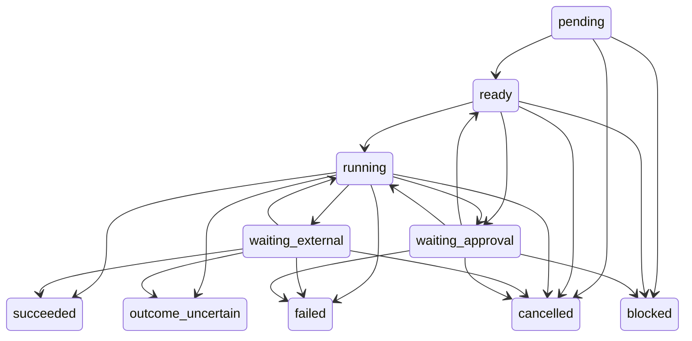

# Fixed bot definitions and revisions

A bot is an existing personal teammate in a teamwork segment. Its teammate id is its bot id.
A teammate without a bot definition continues to use the existing teamwork flows.
Set `AW_BOT_WORKFLOWS=on` to apply migration 0031 and register the bot routes.
The default is off. This contract does not enqueue or execute bot steps.

## Canonical definition

`botDefinitionSchema` in `@agent-works/domain` and `@agent-works/domain/bot-definition` owns the JSON contract.
All objects reject unknown fields. Strings are bounded and trimmed where they represent text.
A definition has `apiVersion: "agent-works.bot/v1"` and the following fields.

| Field                             | Contract                                                          |
| --------------------------------- | ----------------------------------------------------------------- |
| `name`, `purpose`                 | Nonempty text, at most 80 and 2000 characters respectively.       |
| `planning`                        | `{ "mode": "fixed" }`.                                            |
| `workflow.steps`                  | Between 2 and 8 ordered steps.                                    |
| `triggers`                        | Between 1 and 4 manual, schedule, or event triggers.              |
| `approvals.mode`                  | `per_run`, `standing_grant`, or `checkpoints_only`.               |
| `limits.maxConcurrentRunsPerBot`  | Integer from 1 to 5.                                              |
| `limits.maxConcurrentRunsPerUser` | Integer from 1 to 5.                                              |
| `limits.runTimeoutMinutes`        | Integer from 1 to 1440.                                           |
| `limits.maxCostMicros`            | Nonnegative safe integer or `null`. Missing cost remains unknown. |
| `result.destination`              | `inbox`.                                                          |

Each step has an `id` matching `^[a-z][a-z0-9_]{0,31}$`, a title of at most 160 characters,
and at most four distinct `dependsOn` ids. References must name earlier steps.
The dependency graph must be acyclic and every step must reach the single `result` sink.
Every input, including the result's `from`, must belong to the step's dependency closure.

| Step kind        | Additional fields                                                                                                                     |
| ---------------- | ------------------------------------------------------------------------------------------------------------------------------------- |
| `connector_read` | `capability` and `query`. Only `drive.read`, `bigquery.query`, `github.read`, `files.read`, and `notes.read` are allowed.             |
| `skill`          | `skill: { packageId, version, digest, name }` and `inputs: stepId[]`. The digest identifies the whole package. The version is semver. |
| `mcp_delegate`   | `agent: { agentId, protocol: "mcp" }`, `instruction`, `inputs`, and `timeoutSeconds` from 10 to 86400.                                |
| `approval`       | A checkpoint `prompt`.                                                                                                                |
| `result`         | `from: stepId`.                                                                                                                       |

The bot capability set is the union of its `connector_read` capabilities.
Each resolved skill's `allowedTools` must be a subset of that set.
Adding a skill never grants a capability.
The server rejects missing packages, versions, activations, skills, or matching digests.
External agent ids must resolve in the segment's approved registry.

A manual trigger is `{ "kind": "manual" }`.
A schedule trigger specifies `kind`, an IANA `timezone`, `timing`, and an explicit `missedRun` of `skip` or `run_once`.
Its optional `allowedWindow` reuses the schedule contract's weekdays and start/end times.
Timing reuses the schedule contract's five-field cron or interval with an anchor.
Offset-only timezone strings are rejected, even where `Intl` accepts them.
An event trigger has `kind: "event"`, `source`, and `eventType`.
Authentication belongs to the existing signed-event ingestion. A definition does not authenticate an event.

## Validate and confirm publication

`parseBotProposal(unknown)` never throws. It returns either a definition or diagnostics with `code`, `path`, and `message`.
It checks JSON, schema, and graph structure. It grants no authority.
`validateBotDefinition(definition, context)` also checks the current segment policy, approved agents, and exact skill pins.
The resolver is asynchronous, so callers await validation. Validation writes no state.

`previewBot` returns the ordered steps and dependencies, package pins, external agents, and the exact input-output ids sent externally.
The preview also contains trigger descriptions, timezones, missed-run policies, approval mode, checkpoints, limits, and the capability set.
The digest is the canonical SHA-256 of the parsed definition, using `canonicalPayloadSha256`.



Creating or editing a definition always creates a new revision number.
Editing a draft discards that draft. Editing a published definition keeps it active until a new draft is published.
A revision's definition, digest, and provenance never change.
A database trigger permits only draft publication or discard and published supersession.
Published metadata also remains unchanged during supersession. Revisions cannot be deleted.

`publish(member, teammateId, { revision, digest })` locks the teammate row and verifies the latest draft in one transaction.
Publication revalidates current policy and catalogs, supersedes the previous published revision, and updates the active pointer.
A stale revision, changed digest, previously consumed draft, or concurrent revise returns HTTP 409 `stale_confirmation`.
Only one concurrent publication of a draft succeeds.

`pinForRun(teammateId)` returns the active published `{ revision, digest, definition }` for internal execution callers.
`tw_bot_runs` stores that pin with a foreign key that includes the digest.
A run's pin and authority identities are immutable. A later edit does not change an existing run.
The execution caller must authorize the initiating member before using this internal method.

## HTTP routes

All paths start with `/v1/teamwork/bots/:teammateId`.
The shared teamwork router verifies the segment assertion and membership on every request.
Every POST requires the existing CSRF header. A non-owner receives `404 not_found`.
Successful responses use the existing `teamwork.v1` envelope.

| Method and suffix                 | Request                                    | Response                                                                     |
| --------------------------------- | ------------------------------------------ | ---------------------------------------------------------------------------- |
| POST `/drafts`                    | `{ definition, source, sourceMessageId? }` | 201 `{ revision }`. Source is `conversation`, `import`, or `api`.            |
| POST `/drafts/revise`             | `{ baseRevision, baseDigest, definition }` | 201 `{ revision }`. The base may be the current draft or published revision. |
| GET `/preview`                    | None.                                      | `{ preview }` including `revision` and `digest`.                             |
| POST `/publish`                   | `{ revision, digest }`                     | `{ revision }` for the published revision.                                   |
| GET `/active`                     | None.                                      | `{ revision }`, or 404 when none is published.                               |
| GET `/revisions`                  | None.                                      | `{ revisions }` in descending revision order.                                |
| GET `/revisions/:revision/export` | None.                                      | `{ export }` with `apiVersion`, `definition`, `digest`, and `provenance`.    |

Validation failures return 400 `{ error: "invalid_bot_definition", diagnostics }`.
Malformed JSON returns 400 `invalid_request`.
An existing draft makes another create return 409 `draft_exists`. Use revise with its current pin instead.
To import an export, pass its `definition` to the draft endpoint with source `import`.
The envelope records provenance. Parsing `export.definition` reproduces the same canonical digest.

## Resolver and registry ports

R2 implements this exact resolver exported from `@agent-works/domain`.
The validator does not implement a package loader.

```typescript
export type SkillRef = {
  packageId: string;
  version: string;
  digest: string;
  name: string;
};
export type ResolvedSkill = SkillRef & {
  description: string;
  instructions: string;
  allowedTools: readonly string[];
  provenance: { source: 'curated'; path: string; loadedAt: string };
};
export type SkillResolution =
  | { ok: true; skill: ResolvedSkill }
  | {
      ok: false;
      code:
        | 'unknown_package'
        | 'unknown_version'
        | 'digest_mismatch'
        | 'unknown_skill'
        | 'not_activated';
    };
export type SkillPackageResolver = {
  resolve(ref: SkillRef): Promise<SkillResolution>;
};
```

The approved-agent port is `get(agentId): ApprovedBotAgent | undefined`.
Its structural subset requires `agentId`, `displayName`, `protocol: "mcp"`, `dataClassification`,
and `supports` booleans for `cancel`, `lookupByIdempotencyKey`, and `reportsCost`.
R3 owns the full agent registry and startup configuration validation.
The service factory accepts a context provider. The route factory accepts a configured service.
The default service denies every package and external agent until these adapters are wired.

## Authority and approval contract

D07 makes bots private to their owners in v1.
Each run records `owner_sub`, `initiated_by`, and `execution_sub` separately.
An initiator can be the member, `schedule:<id>`, or `event:<source>:<eventId>`.
Execution uses the owner's connections. A non-owner run request must fail as `bot_not_shared`.
Sharing and service execution identities require a later contract.

D08 defines effective authority as the intersection of segment capabilities, member rights,
definition capabilities, active owner connections and installations, run authority, and checkpoint approvals.
Execution must check this intersection at run start, before each step, after every wait, and before every external effect.
Revocation stops subsequent steps. An in-flight external task requires remote cancellation when supported.
If its outcome cannot be established, execution records `outcome_uncertain` and informs the member.

D09 binds per-run approval to the run id, revision digest, and authority-summary digest.
Standing grants use AGT-03 with the teammate id, published revision, and user sponsor.
Expiry, revocation, and budget restrictions continue to apply for each bot and user.
Checkpoint approval binds the run, step, revision digest, and exact next-action input digest.
Wrong actors and stale approvals never authorize execution.
Migration 0031 adds `bot_run` and `bot_checkpoint` subjects and nullable `step_id` to `wb_approvals`.

## Durable execution contract

A run is a `wb_tasks` row of kind `bot` with its pin and identities in `tw_bot_runs`.
A non-null `trigger_ref` is unique per bot for trigger deduplication.
Each `tw_bot_steps` row is unique by task and step id.
The row stores dependencies, attempt, owner token, input, output, idempotency key, error, terminal reason, and timestamps.
Its optional `external` object stores `agentId`, `handle`, `lastStatus`, and `submittedAt`.
The existing `tw_jobs` accepts kind `bot_step`. R5 owns claims, fencing, execution, recovery, and job dispatch.
This revision contract does not enqueue bot jobs or implement any step effects.





`bot-run.ts` owns the full transition tables and `canTransition(kind, from, to)`.
Tests pin every transition. Terminal runs are `completed`, `failed`, `cancelled`, and `outcome_uncertain`.
Terminal steps are `succeeded`, `failed`, `cancelled`, `outcome_uncertain`, and `blocked`.
Terminal states cannot advance, so a late external result cannot resurrect a cancelled run.
The transition tables do not replace execution-time authority or lease checks.

D10 assigns `bot:<taskId>:<stepId>:<attempt>` as the persisted external idempotency key.
A lost submit response requires lookup support or an uncertain outcome. It never authorizes blind resubmission.
D11 keeps missing cost as `unknown`, with completeness `complete`, `partial`, or `unknown`.
The run cost JSON starts with unknown completeness.

## Extension boundaries

`planning.mode` other than `fixed` yields `unsupported_planning_mode`.
Dynamic planning must define a new versioned contract for plan generation, review, authority, and durable pinning.
It cannot add steps to a published v1 revision.
An external protocol other than `mcp`, including `a2a`, yields `unsupported_protocol`.
A2A needs its own approved transport and task lifecycle adapter before the schema can accept it.
Neither extension can bypass revision confirmation, owner isolation, or approval binding.
