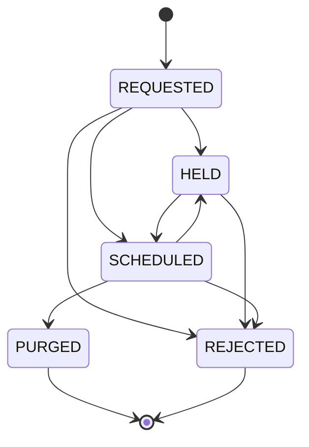

# Retention, legal holds and deletion requests

## Retention sweeps

`sweepRetention(port, at, limit)` selects records whose expiry is at or before
the supplied clock, orders them by expiry then identity, skips held records and
purges at most `limit` eligible records. The default is 100; valid limits are
whole numbers from 1 through 10,000. Run subsequent sweeps to drain a backlog.
Held records do not consume the purge budget.

Purging removes the encrypted parent and every registered derived envelope in
the same transaction. It appends one tombstone and one `purge` audit event. The
record identity keys the evidence, so a retry cannot emit a second purge event.
An expired record is unreadable even before the sweep physically removes it.
A hold preserves bytes for legal handling; it does not extend ordinary read TTL.

`retentionSweepPlan` exposes the operation as an existing local engine workflow
step. Cancellation is checked before entering the purge transaction. The engine
checkpoints a receipt containing purge and hold counts. A crash after a purge but
before a receipt is recovered by an idempotent sweep; committed deletion evidence
continues to prove what happened even if a recovery receipt reports zero new rows.

## Hold commands

A hold command contains `commandId` (UUID), a target, `action` (`set` or `release`)
and an opaque `reasonRef`. Targets are a record, an owner or a source. The
verified officer is recorded by the service, never accepted from the command.
The command stream has a strictly increasing contiguous sequence.

Each target has one current state determined by its most recent command. A
record is held if any applicable target remains set. Releasing an owner hold
therefore does not release an independent source or record hold. Holds apply to
newly ingested matching records as well as existing records.

A reason reference links external case evidence; it is not a second independent
hold slot for the same target. If several cases share one target, the operator
must reconcile all cases before releasing that target. Setting a record hold
for an already tombstoned record is rejected rather than implying recovery.

A command can be retried with the same UUID and exact identity. Reusing its UUID
with a different actor, target, action or reason is a conflict. Releasing a hold
appends another command and audit event; it never mutates or deletes the set
command. A release lets the next eligible sweep or deletion pass remove bytes.

## Deletion lifecycle

Create a per-user request with a UUID, owning subject and opaque reason reference.
Creating the request immediately fences new artifact and derived intake for that
owner. Ordinary reads are also fenced before physical purge. The verified
privacy officer or admin is the actor; the subject is the user whose data is
being handled.

`deletionPlan` is a reviewable fan-out projection across artifact rows, derived
rows, tombstones, governance audit and offline backups. Managed services always
carry `operator evidence pending`. Review this projection before processing a
request in operational tooling.

`processDeletion` checks all matching records under the same transaction lock.
If any is held, the whole request becomes `HELD` and all owner rows remain. After
all applicable holds are released, processing moves through `SCHEDULED` to
`PURGED` and removes matching artifact and derived rows atomically. Both state
transitions have separate revisioned audit events even when committed together.
A request for an owner with no rows still reaches `PURGED` and retains its fence.

Processing a terminal request is a no-op. Reprocessing a held request without a
new state change appends no duplicate transition. A `PURGED` request permanently
fences future owner intake in this local model. Re-onboarding a subject needs an
explicit later design; changing the old request is forbidden.

`rejectDeletion` is a service operation requiring a nonempty rejection evidence
reference. It retains payloads and ends that request's intake fence. Other active
requests or source revocations can still deny intake. A rejected request is also
terminal and cannot be reopened or have its rejection evidence replaced.

## Revocation

`revokeSource` records an immutable source fence and purges matching unheld
artifacts and derived rows. Held bytes remain physically stored but inaccessible
through ordinary reads and derivation. Re-running revocation after a hold is
released purges the remaining bytes. New intake from a revoked source fails.

## Logs, exports and backups

Governance audit stores hashes, timestamps, request linkage, state and the marker
`governance-tombstone-v1`. It never stores the deleted content, raw owner or raw
source identifier in purge events. Tombstones preserve the record identity,
content hash, owner/source hashes, purge reason, clock and request linkage.

Privileged request and hold records retain actor, subject and case references as
legal evidence. Restrict these admin data. Hashes are linkable; retaining an audit
marker does not make all evidence anonymous. Free-form content should not be used
as a `reasonRef`.

SIEM exports project only allowlisted marker fields. Existing audit history is
retained rather than erased. Operators apply separate log retention and backup
expiration policies. A restored snapshot must replay current evidence before
ordinary reads or intake are enabled; see the [restore drill](restore-drill.md).
