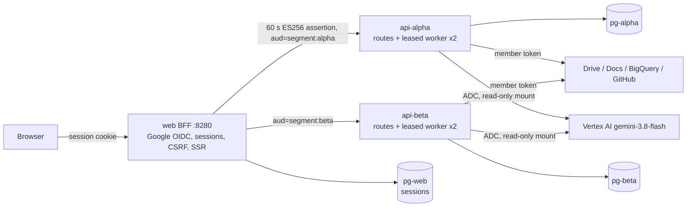

# Agent Works M1: personal AI teammates on local Compose

Members delegate work to personal AI specialists, step away, and come back to decisions and results in an inbox. Three workflows share one experience:

- **Research to decision brief.** Specialists read a segment's Google Drive research folder. A coordinator writes an evidence-backed brief, which the member can publish as a Google Doc after approving its exact content.
- **Business metrics to explanation.** A data specialist runs approved, read-only BigQuery queries. A context researcher reads business notes in Drive. The coordinator explains the change using numbers the workbench calculated, not the model.
- **Engineering request to implementation proposal.** Specialists read a GitHub issue and code at a pinned commit. The coordinator writes a proposal. Nothing in GitHub is changed.

Work runs in one of two isolated **segments** (`alpha`, `beta`). Each has its own backend, database, catalog, teammates, tasks, connections, token key and model budget.

## What is real

| Part                          | Status                                                                                                                                                                                                                                                                                                                                                                |
| ----------------------------- | --------------------------------------------------------------------------------------------------------------------------------------------------------------------------------------------------------------------------------------------------------------------------------------------------------------------------------------------------------------------- |
| Model                         | **Real.** Vertex AI `gemini-3.8-flash`, project `ubie-yu-sandbox`, location `global`, through host ADC mounted read-only into `api-alpha` and `api-beta` only. There is no stub, replay or fallback model in the segment APIs. `LLM_MODE` other than `vertex` refuses every generation.                                                                               |
| Member identity               | **Real Google OpenID Connect** in live mode (authorization code, PKCE, state, nonce, RS256 ID-token verification, server-side sessions). Local-test mode offers `alice@local.test` and `bob@local.test`, labelled on every page. Those identities can never satisfy a live gate, because the segment APIs accept assertions only from the issuer matching their mode. |
| Drive, Docs, BigQuery, GitHub | **Real** in live mode, using each member's own per-segment OAuth connection. Local-test mode reads the seed files in `fixtures/m1/`, and every item says `FIXTURE (local seed file, not a live service)`. Fixture runs never count as live evidence.                                                                                                                  |

The model credential (ADC) proves nothing about the member and is never used to read sources. Sign-in proves who the member is. Source access is connected separately in each segment.

## Setup

1. Docker with Compose v2 (Rancher Desktop works).
2. `gcloud auth application-default login`, then `gcloud auth application-default set-quota-project ubie-yu-sandbox`. Plain `gcloud auth login` does not create ADC.
3. OAuth clients and the local secrets file: `docs/m1/SETUP_OAUTH.md`. An empty template is in `docs/m1/m1.env.example`.
4. Live test resources (Drive folders, BigQuery datasets, GitHub issues): `docs/m1/SETUP_RESOURCES.md`.
5. `pnpm m1:doctor` checks prerequisites without printing secrets. `pnpm m1:doctor -- --live` also spends one Vertex call per segment (stack must be up).

## Commands

| Command                                    | Does                                                                                                                                                             |
| ------------------------------------------ | ---------------------------------------------------------------------------------------------------------------------------------------------------------------- |
| `pnpm m1:up`                               | Build into a volume, migrate, start both segments in live mode, wait for health. Refuses to start and lists missing settings if any live prerequisite is absent. |
| `pnpm m1:up:local`                         | Start the separate local-test stack (project `aw-m1-local`, `http://localhost:8281`) with local-test identities and fixture sources. The model is still real.    |
| `pnpm m1:down`                             | Stop both stacks and keep their data.                                                                                                                            |
| `pnpm m1:reset -- --yes-delete-m1-volumes` | Delete the live stack's volumes (add `--local-test` for the local stack). This also deletes the call ledger, so run it only after the campaign.                  |
| `pnpm m1:test`                             | In the toolbox: install, build, typecheck, ESLint, every unit and integration test.                                                                              |
| `pnpm m1:e2e:local` / `pnpm m1:e2e:live`   | Playwright in the `e2e` container against the matching stack, with retries disabled.                                                                             |
| `pnpm m1:evidence`                         | Live journeys with video, plus the screenshot sweep, into `artifacts/m1/` with `evidence-index.md`.                                                              |
| `pnpm m1:verify`                           | Every machine gate. Non-zero if any fails or a live prerequisite is missing. Human gates are reported as `PENDING` and never counted as passed.                  |

The live app is `http://localhost:8280`. Only `web` publishes a port, bound to `127.0.0.1`. Its internal port 8081 (assertion JWKS and the gated e2e session endpoint) is never published.

## Architecture

- `packages/domain/src/teamwork*.ts` holds the shared model and pure rules: task and assignment transition tables, schemas, capability intersection, claim-support checks, revision diff, the portable-definition allowlist, and the inbox reducer.
- `apps/api/src/teamwork/` is the segment API: catalog, teammates, conversations, tasks, plans, assignments, revisions, approvals, connections, source adapters, model gate and worker.
- `apps/api/migrations/0018_teamwork.sql` extends the P0 workbench tables (`wb_tasks`, `wb_events`, `wb_approvals`, `wb_actions`, `wb_evidence`, `wb_model_calls`), so there is one task history, one approval store and one call ledger. P0 rows keep their meaning through defaults.
- `apps/web/app/m1/` is the BFF and server-rendered UI. `apps/web/client/m1.ts` is progressive enhancement only.
- `compose.m1.yaml` runs both segment stacks. `scripts/m1/run.mjs` implements every `m1:*` command.

### Execution

Every state change and the job it needs are written in one transaction to `tw_jobs`. Each segment runs `AW_M1_CONCURRENCY` (default 2) claim loops with leases. Assignments therefore really run in parallel. A crashed worker's job is reclaimed when its lease expires, and after 3 crashed attempts the assignment fails as `stale` instead of retrying forever. Assignments have deadlines and stop at step boundaries when a task is cancelled. Successful contributions are always kept. When one is missing, the task asks the member to retry or to continue with the limitation stated.

Coordinator plans come from a real model call and are stored as digest-bound versions. No assignment job exists until the member approves that exact version. An edit creates a new version that needs its own review. Publishing needs a separate approval of the exact account, title and content of one revision. A newer revision voids it. A Docs write that may have happened is reconciled through a Drive `appProperties` marker, a provider-side lookup, before any retry.

### Evidence and numbers

Unknown citation IDs are dropped. Every fact or calculation is then checked deterministically. Each number and date it states must appear in a cited source, or match a cited calculation within 0.5% relative, 0.01 absolute, or 0.1 percentage points. Its wording must also overlap the cited passage. A statement that fails is kept but marked "not supported by its cited sources; treat as inference". Metric changes are computed by the workbench from BigQuery results (`sources/metrics.ts`). They are verified against the independent manifests in `fixtures/m1/expected/`.

## Budget

Yu's campaign limit is 600 real Vertex calls. Every request reserves a ledger row in `wb_model_calls` under an advisory lock before it leaves the process. Retries (at most one, only for `rate_limited` and `unavailable`) are separate rows, and restarts cannot reset the count. Each Compose project and segment has its own durable ledger, and the caps sum to 600:

| Ledger                                | Cap       |
| ------------------------------------- | --------- |
| live `aw-m1` alpha / beta             | 200 / 200 |
| local-test `aw-m1-local` alpha / beta | 100 / 100 |

Per-call output caps are 4096 tokens for plans, 6144 for contributions, 8192 for synthesis and 1024 for replies, with a 60 s timeout. Gemini 3.8 counts thinking tokens against the cap. Usage is shown in the header and on Connections, and is recorded in `docs/m1/PROGRESS.md`.

## Security notes

- Membership, segment entitlement and resource ownership are enforced in each segment API on every request. Another member's IDs answer 404. A token for one segment is rejected by the other (audience).
- Effective capabilities are segment policy ∩ member entitlement ∩ teammate request ∩ task sources ∩ active connections, computed in `teamwork-policy.ts`. Model output can name capabilities but never grant them. Plans that ask for sources a teammate cannot use are stripped before review.
- Connection tokens are AES-256-GCM sealed with a key generated in the segment's own volume. A Google connection must belong to the signed-in member's own account.
- Source text reaches the model inside the JSON source-data envelope with an instruction never to follow it. The seed corpus contains prompt-injection canaries.
- Exports use an explicit field allowlist and are scanned for known secret shapes, emails and the member's own identifiers before download. Imports reject unknown fields (such as `connections`) and create recipient-owned objects with capabilities as requests only.
- CSP blocks inline script. All text is escaped. Links are limited to `https:` and same-segment fixture pages.

## Troubleshooting

| Symptom                                   | Fix                                                                                           |
| ----------------------------------------- | --------------------------------------------------------------------------------------------- |
| `m1:up` lists missing settings            | Fill `~/.config/agent-works-m1/m1.env` (SETUP_OAUTH, SETUP_RESOURCES).                        |
| Model `adc_unavailable`                   | `gcloud auth application-default login`, then `pnpm m1:up`.                                   |
| `model_not_found`                         | Location must be `global`; the model is not served in `us-central1`.                          |
| `budget_exhausted`                        | The ledger cap was reached. Raising it is Yu's decision, never automatic.                     |
| Connection shows `scopes_missing`         | Reconnect and keep every requested permission checked on Google's consent screen.             |
| `connection_account_mismatch`             | Connect the same Google account you signed in with.                                           |
| Live e2e says re-authentication is needed | Sign in once at `http://localhost:8280` in the host browser for that member.                  |
| ADC unreadable on Linux                   | The scripts pass `HOST_UID`/`HOST_GID` automatically; export them if running Compose by hand. |

## Limitations

See `docs/m1/ACCEPTANCE_REPORT.md` for the current gate status. Member publishing of definitions to a shared catalog (optional in the brief) is not implemented; export and import of private definitions is.
