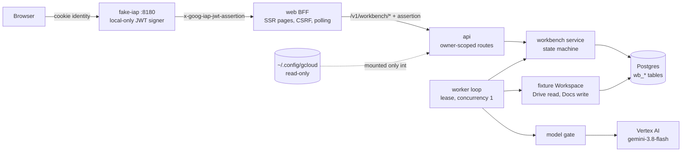
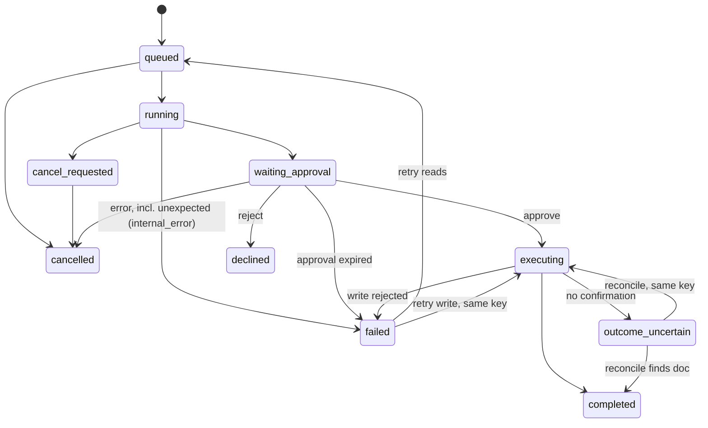

# Agent Works P0 workbench

A governed AI workbench that runs entirely on a developer machine through Docker Compose.
The flagship task is:

> Review the October incident reports in my authorized Google Drive, identify recurring
> causes with citations, and draft a summary Google Doc for my approval.

A user starts a task, watches persisted activity, inspects cited evidence, reviews a draft
report, approves one precisely described document write, and opens the result. Refreshing
the page or restarting the stack keeps the task, its events, the decision and the result.

What is real and what is simulated:

| Part              | Status                                                                                                                        |
| ----------------- | ----------------------------------------------------------------------------------------------------------------------------- |
| LLM               | **Real.** Vertex AI `gemini-3.8-flash` in `ubie-yu-sandbox`, location `global`, through your Application Default Credentials. |
| Google Drive read | **Simulated.** A deterministic fixture corpus with per-document readers (`apps/api/src/workbench/fixture-corpus.ts`).         |
| Google Docs write | **Simulated.** A fixture Docs store (`wb_fixture_docs`) with idempotency keys. No real document is created.                   |
| Identity          | **Local only.** A fake IAP proxy signs IAP-shaped JWTs for `alice` and `bob`.                                                 |

The UI labels every simulated surface ("Simulated Workspace", "Simulated write", "Fixture
Drive"). Live Drive and Docs integration is pending and not claimed anywhere.

## Prerequisites

- Docker with Compose v2 (Rancher Desktop, Docker Desktop or OrbStack).
- The gcloud CLI and access to `ubie-yu-sandbox` with `roles/aiplatform.user`.
- Application Default Credentials. `gcloud auth login` alone does **not** create them:

  ```bash
  gcloud auth application-default login
  gcloud auth application-default set-quota-project ubie-yu-sandbox
  ```

  This writes `~/.config/gcloud/application_default_credentials.json`.

## Run

```bash
pnpm p0:up        # docker compose -f compose.p0.yaml up --build -d --wait ... (see package.json)
open http://localhost:8180
```

Pick a test identity on the sign-in page. `pnpm p0:down` stops the stack; data stays in the
`p0-postgres-data` volume. `docker compose -f compose.p0.yaml down -v` deletes it.

Composer keys: **Ctrl+Enter** (⌘+Enter on macOS) starts the task; **Enter** inserts a new
line. The submit button disables itself and the server deduplicates on a per-form
`clientRequestId`, so double submits create one task.

### Services

| Service          | Port             | Role                                                                                                        |
| ---------------- | ---------------- | ----------------------------------------------------------------------------------------------------------- |
| `fake-iap`       | `127.0.0.1:8180` | Entry point. Local sign-in and IAP JWT signing in front of `web`.                                           |
| `web`            | internal         | BFF: server-rendered pages, CSRF, polling fragments.                                                        |
| `api`            | internal         | Workbench API, worker, Vertex adapter. **Only service with the ADC mount.**                                 |
| `fake-directory` | internal         | Roles and groups for the existing auth stack.                                                               |
| `postgres`       | internal         | Tasks, events, evidence, artifacts, approvals, actions, fixture docs.                                       |
| `builder`        | none             | One-shot: copies the checkout into the `p0-app` volume, installs, builds. Skips when sources are unchanged. |

Only `fake-iap` publishes a port, bound to `127.0.0.1`.

### Configuration

Compose reads `AW_P0_*` names so host variables such as `GOOGLE_CLOUD_LOCATION` cannot leak
into the containers. Defaults are the authorised values.

| Variable                      | Default            | Effect                                                                          |
| ----------------------------- | ------------------ | ------------------------------------------------------------------------------- |
| `AW_P0_GOOGLE_CLOUD_PROJECT`  | `ubie-yu-sandbox`  | Vertex project                                                                  |
| `AW_P0_GOOGLE_CLOUD_LOCATION` | `global`           | Vertex location (`gemini-3.8-flash` returns 404 in `us-central1`)               |
| `AW_P0_VERTEX_MODEL_ID`       | `gemini-3.8-flash` | Publisher model ID; set to empty to see the not-configured state                |
| `AW_P0_LLM_MODE`              | `vertex`           | `stub` selects the offline stub model (CI and fixture tests only)               |
| `AW_P0_MAX_MODEL_CALLS`       | `150`              | Hard cap on real Vertex requests sent; a non-integer value fails closed to 0    |
| `AW_P0_FIXTURE_FAULTS`        | `0`                | `1` enables `[fixture:…]` and `[stub:…]` fault markers for tests                |
| `GCLOUD_CONFIG_DIR`           | `~/.config/gcloud` | Host gcloud directory mounted read-only into `api`                              |
| `AW_P0_PORT`                  | `8180`             | Host port                                                                       |
| `HOST_UID` / `HOST_GID`       | `1000`             | Container UID; set to `id -u`/`id -g` on Linux so the 0600 ADC file is readable |

### ADC inside Compose

`api` mounts `${GCLOUD_CONFIG_DIR:-$HOME/.config/gcloud}` at `/home/app/.config/gcloud`
read-only, with `HOME=/home/app`, `CLOUDSDK_CONFIG=/home/app/.config/gcloud` and
`GOOGLE_APPLICATION_CREDENTIALS` pointing at the ADC file. No other service has the mount.
Nothing is copied into an image: the runtime image (`dev/p0/Dockerfile`) contains only Node
and pnpm, and the builder copies only `package.json`, the lockfile, workspace config,
`apps`, `packages`, `agents/skills`, `contracts`, `schemas`, `fixtures` and `dev/p0`.

## Verify the model

```bash
docker compose -f compose.p0.yaml exec -T api node apps/api/dist/workbench/vertex-smoke.js
```

One bounded call (256 output tokens, at most one retry on a transient error). It prints
project, location, configured model, returned `modelVersion`, `responseId` and latency, and
exits non-zero if the stack is in stub mode, config is missing, or the returned model does not
match. It never prints tokens or credential paths.

## Modes

| Mode           | How                     | Used by                                                                                                   |
| -------------- | ----------------------- | --------------------------------------------------------------------------------------------------------- |
| Real (default) | `AW_P0_LLM_MODE=vertex` | Product, `real-llm` suite, G1 smoke                                                                       |
| Stub           | `AW_P0_LLM_MODE=stub`   | Broad fixture E2E suite and CI. Labelled **STUB MODEL** in the header, on every task and on every report. |

There is no silent fallback: a Vertex error fails the task with a classified code and a
remediation message (`adc_unavailable`, `permission_denied`, `api_disabled`,
`billing_disabled`, `model_not_found`, `rate_limited`, `timeout`, `unreachable`,
`unavailable`, `invalid_output`, `budget_exhausted`, `not_configured`).

## Test

Everything runs in containers. The host never runs Node against the repo.

```bash
pnpm p0:e2e                                 # all suites below, in order
node scripts/p0-e2e.mjs fixture             # stub model + fixture faults, 33 browser tests
node scripts/p0-e2e.mjs misconfig           # empty VERTEX_MODEL_ID, readiness guidance
node scripts/p0-e2e.mjs restart             # create tasks, restart every service, verify
node scripts/p0-e2e.mjs real                # G1 smoke + real Gemini flagship with video (2 calls)

docker compose -f compose.p0.yaml run --rm -T --no-deps toolbox sh -c 'pnpm test'
docker compose -f compose.p0.yaml run --rm -T --no-deps toolbox sh -c 'pnpm typecheck && pnpm lint:eslint'
```

Outputs:

- `artifacts/p0/results-<suite>.json`: Playwright JSON results per suite.
- `artifacts/p0/screenshots/`: state screenshots (`01`–`14` fixture, `20`–`25` real model). Written locally by each suite run and gitignored; no CI workflow uploads them.
- `artifacts/p0/videos/flagship-real-gemini.webm`: the real-model flagship flow, recorded locally by the `real` suite. Gitignored; no CI workflow uploads it.
- `artifacts/p0/vertex-smoke.json`, `artifacts/p0/real-llm-evidence.json`: sanitised
  real-call metadata.
- `artifacts/p0/test-results/` and `artifacts/p0/report-*/`: traces and HTML reports
  (gitignored, kept on failure).

### Visual baselines (local only)

Visual regression is local-only by Yu's decision: baselines are not committed
(`e2e/p0/__screenshots__/` is gitignored) and CI never runs `e2e/p0/fixture/visual.spec.ts`
(the P0 config ignores it when `GITHUB_ACTIONS=true`). Times, ids and fingerprints are masked.

- First run on a checkout: `node scripts/p0-e2e.mjs fixture` sees no baselines, generates them
  from the current UI, then runs the full suite against them. Review the new PNGs before
  trusting later comparisons, because a first run cannot catch a regression.
- Regenerate after an intended UI change (stack running in stub mode, for example after
  `node scripts/p0-e2e.mjs fixture`):

  ```bash
  docker compose -f compose.p0.yaml run --rm --no-deps -T e2e \
    node_modules/.bin/playwright test -c e2e/p0/playwright.config.ts visual \
    --update-snapshots=all --project fixture
  ```

Open every changed PNG and confirm the change is the one you intended. Never update baselines
to make an unexplained diff pass.

## Cost controls

- Concurrency 1: one worker loop per api process runs one task at a time.
- `maxOutputTokens` 4096 for reports and 256 for the smoke check; temperature 0.2; 60 s timeout.
- `AW_P0_MAX_MODEL_CALLS` caps real calls: `wb_model_calls` rows with `mode = 'vertex'` and `sent = true`. Failures before a request leaves the process (missing ADC, unreachable) do not count.
- The broad suites use the stub, so only `real` spends Vertex calls (2 per run).

## Architecture



Task states (`packages/domain/src/workbench.ts` owns the transition table):



Key files:

- `apps/api/src/workbench/service.ts` owns persistence, transitions, decisions and readiness.
- `apps/api/src/workbench/worker.ts` claims leased tasks and runs retrieval, the model call, citation validation, the draft and the approved write.
- `apps/api/src/workbench/report.ts` owns the prompt, the response schema, citation validation and the approval digest.
- `apps/api/src/workbench/vertex.ts` is the Vertex adapter with error classification.
- `apps/api/src/workbench/routes.ts` is the versioned `workbench.v1` HTTP contract.
- `apps/web/app/workbench/` holds the BFF pages, CSRF and design system. `apps/web/client/workbench.ts` is progressive enhancement only.
- `apps/api/migrations/0017_workbench.sql` is applied once under an advisory lock.

### Frontend choice

Server-rendered TSX through the repo's existing escaping `h()` renderer, plus about 200 lines
of progressive-enhancement script (polling, Ctrl+Enter, copy, drawer). No React, bundler or
client router. Reasons: the BFF already owns the IAP assertion and CSRF, every page works
without script, auto-escaping covers all model and source text, and a strict CSP
(`script-src 'self'`, no inline script or style) holds. Polling replaces one region only when
the task version changes, so focus is kept and screen readers get one status announcement.

## API contract (`workbench.v1`)

All routes need the IAP assertion. POSTs also need `x-csrf-token` (the BFF validates the
real double-submit token and origin). Another owner's task returns **404**, never 403.

| Method | Path                                               | Notes                                                                                          |
| ------ | -------------------------------------------------- | ---------------------------------------------------------------------------------------------- |
| GET    | `/v1/workbench/readiness`                          | Identity, model mode and state, call budget, Workspace mode                                    |
| GET    | `/v1/workbench/tasks`                              | Owner's tasks, newest first                                                                    |
| POST   | `/v1/workbench/tasks`                              | `{objective, clientRequestId}`; 201 created, 200 replay, 409 reused id                         |
| GET    | `/v1/workbench/tasks/:id`                          | Task, ordered events, evidence, artifact, approval, action                                     |
| POST   | `/v1/workbench/tasks/:id/approval`                 | `{decision, expectedPayloadSha256}`; 409 `stale_digest`, `already_decided`, `approval_expired` |
| POST   | `/v1/workbench/tasks/:id/{cancel,retry,reconcile}` | 409 when the state does not allow it                                                           |
| GET    | `/v1/workbench/fixture/{drive,docs}/:id`           | Owner-scoped simulated source and created doc                                                  |

## Security assumptions

- **Opt-in in every service.** The api starts the workbench (migration, routes, worker) only
  with `WORKBENCH_ENABLED=1`, and the web app mounts its pages only with `WEB_WORKBENCH=1`.
  Only `compose.p0.yaml` sets either.

- **Local-only identity.** The fake IAP signs with an ephemeral key generated at start-up.
  The api trusts it only because `IAP_JWKS_URL`, `IAP_ISSUER` (`https://fake-iap.local`) and
  `IAP_AUDIENCE` point at it in `compose.p0.yaml`. Production config names Google's issuer
  and keys, so a fake token cannot verify there. Cookie sign-in exists only when
  `FAKE_IAP_SIGN_IN=1`, which only `compose.p0.yaml` sets.
- **Authorization is server-side.** Every query filters on `owner_sub`; the browser never
  decides. Approvals revalidate owner, state, digest, expiry and content integrity inside one
  transaction, and the worker re-checks the digest before writing.
- **Writes need a captured approval.** Approve inserts the action row with idempotency key
  `wb:<task>:<approval>` in the same transaction. Retries and reconcile reuse it, and the
  Docs store dedupes on it.
- **Untrusted content.** Evidence goes to the model inside a JSON source-data envelope; the
  system prompt forbids following embedded instructions. Model citations to unknown sources
  are dropped and counted. All text is HTML-escaped. Links are limited to same-origin fixture
  paths or `https:` in the API and again in the view. CSP blocks inline script.
- **Secrets.** No credentials in images, the repo or logs. The ADC directory is read-only and
  only in `api`. Logs from the worker carry error class names only.

## Troubleshooting

| Symptom                                                   | Fix                                                                                               |
| --------------------------------------------------------- | ------------------------------------------------------------------------------------------------- |
| Connections shows `adc_unavailable`                       | Run `gcloud auth application-default login`, then `pnpm p0:up`.                                   |
| `model_not_found`                                         | Check `AW_P0_GOOGLE_CLOUD_LOCATION` is `global`; the model is not served in `us-central1`.        |
| `permission_denied` / `api_disabled` / `billing_disabled` | Grant `roles/aiplatform.user`, enable `aiplatform.googleapis.com`, or fix billing on the project. |
| `budget_exhausted`                                        | Raise `AW_P0_MAX_MODEL_CALLS` deliberately.                                                       |
| UI shows old code after a change                          | `pnpm p0:up` force-recreates app services; plain `docker compose up` does not restart them.       |
| ADC unreadable on Linux                                   | Export `HOST_UID=$(id -u) HOST_GID=$(id -g)`.                                                     |

## Known limitations

- Drive and Docs are fixtures. Live Workspace, OAuth consent and the `drive.file` write
  scope are not implemented.
- Tasks are one-shot. Follow-up turns are not supported; the UI says so.
- Polling, not streaming. Updates arrive within about 1.5 s.
- The legacy `/v1/ask` page, OAuth connections page and existing approvals/admin pages are
  not part of P0. In this stack `/connections` shows workbench readiness instead.
- Automated checks are proxies for usability. See `UX_REVIEW.md` for the human review list.
