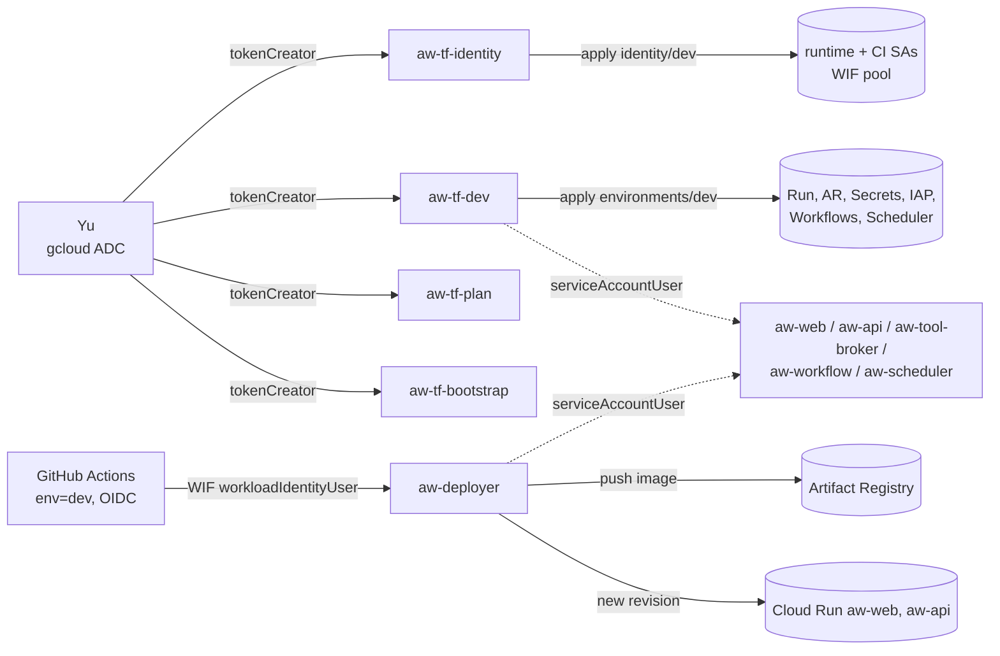
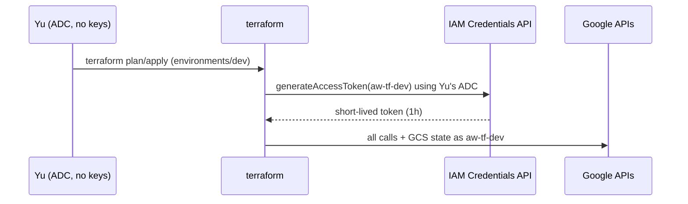

# agent-works — Terraform design for Google Cloud dev

Status: **design approved 2026-10-15 (all recommended defaults, see §12). Implemented in `infra/terraform/` (#154) and updated for adopted-project bootstrap (#155).**
Inputs read: `infra/terraform/**`, `.github/workflows/infra.yml`, `.github/workflows/infra-plan.yml`, RFC-001 §5, §14, ADR `docs/adr/0003-pilot-decisions.md`,
`docs/runbooks/cloud-workflows-dev.md`, `docs/runbooks/terraform-bootstrap.md`, `docs/plans/phase3-readiness-matrix.md`, `apps/api/src/config.ts` and the env reads in `apps/**`,
`docs/governance/encryption-and-redaction.md`, `docs/analytics/integration.md`, `docs/scheduling/README.md`.

Yu's hard rules (binding):

1. **Modules never create service accounts.** They take SA emails as inputs.
2. **One SA per responsibility**, least privilege, roles granted at the narrowest resource.
3. **Impersonation everywhere.** Terraform impersonates a terraform SA, there are no SA keys, CI uses WIF to impersonate the deployer, and humans get `roles/iam.serviceAccountTokenCreator` only on specific SAs.

---

## 1. Repository architecture and alignment with the rules

| Fact (repo)                                                                                                                                                                                                                      | Path                                                                                                        | Implementation                                                                                                                                    |
| -------------------------------------------------------------------------------------------------------------------------------------------------------------------------------------------------------------------------------- | ----------------------------------------------------------------------------------------------------------- | ------------------------------------------------------------------------------------------------------------------------------------------------- |
| `bootstrap/` adopts the existing project (`data "google_project"`), creates the state bucket and the 4 Terraform SAs (`aw-tf-identity`, `aw-tf-dev`, `aw-tf-plan`, `aw-tf-bootstrap`), and owns optional baseline/guard switches | `infra/terraform/bootstrap/{main,iam,provisioning,variables,outputs}.tf`                                    | Replaces the retired `modules/environment`. Guards, default-SA deprivilege, audit logs and billing IAM are opt-in for adopted projects.           |
| `modules/workflows` takes `workflow_service_account_email` (`aw-workflow`) instead of creating an identity                                                                                                                       | `infra/terraform/modules/workflows/main.tf`                                                                 | Complies with rule 1. Bootstrap owns the `pilot_durable_tasks_adapter` custom role; `modules/workflows` keeps distinct-identity validations.      |
| Dev root reads `aw-*` SA emails from `identity/dev` remote state (`service_account_emails` fallback for offline tests)                                                                                                           | `infra/terraform/environments/dev/main.tf`                                                                  | Every workload resource lives in a module and accepts existing SA emails (§3, §4).                                                                |
| `identity/dev` and `environments/dev` configure GCS backends and `impersonate_service_account` on both provider and backend                                                                                                      | `infra/terraform/{identity,environments}/dev/{backend,providers,versions}.tf`                               | Bootstrap is the only local-first provider exception (§5, §6).                                                                                    |
| Pins: Terraform `>=1.16.5,<1.17.0`, google `8.5.0`                                                                                                                                                                               | `versions.tf` (all roots and modules)                                                                       | GA `hashicorp/google` `8.5.0` everywhere; `google-beta` is not used (§9, §12.1).                                                                  |
| CI runs offline checks (`fmt`, `init -backend=false`, `validate`, `terraform test`, `tflint`, Checkov, `evidence.mjs`) plus an inert read-only plan workflow                                                                     | `.github/workflows/infra.yml`, `.github/workflows/infra-plan.yml`                                           | Offline checks run on every PR; `.github/workflows/infra-plan.yml` stays skipped until `TF_PLAN_WIF_PROVIDER` and `TF_PLAN_SA` are set (§6, §12). |
| Workload foundations and runtime services (Cloud Run, direct IAP, Secret Manager containers, Artifact Registry, WIF, runtime APIs)                                                                                               | `infra/terraform/modules/*`, `infra/terraform/identity/dev/*`, `infra/terraform/environments/dev/*`         | Covered by the modules in §2–§3.                                                                                                                  |
| Runtime config the API reads: `DATABASE_URL`, `IAP_AUDIENCE/ISSUER/JWKS_URL`, `DRIVE_WORKER_TOKEN`, `OAUTH_URL`, `OAUTH_PUBLIC_URL`, `LLM_URL`, `DIRECTORY_URL`, `ADMIN_TRUSTED_ORIGINS`, `PORT`, `NODE_ENV`                     | `apps/api/src/config.ts`, `rg process.env apps`                                                             | Drives the secrets list (§8) and the Cloud Run env (module `cloud_run_service`).                                                                  |
| Cloud KMS, BigQuery, Cloud Scheduler, Pub/Sub and Eventarc are only **feature-gated stubs**                                                                                                                                      | `docs/governance/encryption-and-redaction.md`, `docs/analytics/integration.md`, `docs/scheduling/README.md` | Modules for them are implemented and **off by default** (`enable_* = false`).                                                                     |
| Postgres / Cloud SQL target                                                                                                                                                                                                      | `docs/adr/0003-pilot-decisions.md`                                                                          | Resolved D1: off-cloud. The `cloud_sql` module is implemented and off by default (`enable_cloud_sql = false`).                                    |

## 2. Directory layout

```text
infra/terraform/
  bootstrap/                  # root 0, applied ONCE by Yu with his own ADC (no SA yet). Local state, then migrated to GCS.
    main.tf iam.tf provisioning.tf  # adopts existing project (data "google_project"), state bucket, aw-tf-* SAs, tokenCreator grants, conditioned dev IAM and custom roles
  identity/dev/               # root 1, runs as aw-tf-identity. Creates ALL runtime/CI SAs + WIF pool/provider
    service_accounts.tf       #   google_service_account resources (the ONLY place besides bootstrap that creates SAs)
    impersonation.tf          #   serviceAccountUser attach bindings on individual SAs
    wif.tf                    #   uses modules/github_wif + workloadIdentityUser bindings
    outputs.tf                #   map of SA emails and WIF metadata -> consumed by envs/dev via terraform_remote_state
  environments/dev/           # root 2, runs as aw-tf-dev (or aw-tf-plan for read-only plan). Every resource lives in a module; SA emails come in as inputs
    backend.tf providers.tf versions.tf variables.tf main.tf tenant.tf workflows.tf outputs.tf
  modules/
    project_baseline/         # hardens an existing project: APIs, optional audit config, optional org-policy guards, optional default-SA deprivilege
    budget/                   # alerts-only billing budget (ADR 0003)
    project_iam/              # project-level role grants for given SA emails (bootstrap custom provisioning grants are colocated with their roles)
    artifact_registry/
    secrets/
    cloud_run_service/        # one service + its invoker IAM + optional direct IAP
    iap_access/               # IAP accessor grants for test users/groups
    workflows/                # takes workflow_service_account_email and assigns the bootstrap-owned custom adapter role
    scheduler_job/            # off by default
    kms/                      # off by default
    cloud_sql/                # off (D1)
    network/                  # VPC + Direct VPC egress, off (D10)
    bigquery_analytics/       # off by default (analytics BigQuery switched off)
    github_wif/               # pool + provider (used by identity root)
```

Why three roots: the identity root holds IAM power (it creates SAs and the WIF provider). Keeping it apart from the workload root means `aw-tf-dev` never needs `iam.serviceAccountAdmin`. This is RFC §14.1: "Avoid granting a single deployment identity Owner".

## 3. Modules: purpose, inputs and outputs, resources

No module declares `google_service_account` or `google_service_account_key`. CI enforces this in `infra/terraform/evidence.test.mjs` (`identityViolations()`) and `environments/dev/tests/contracts.tftest.hcl`.

| Module               | Purpose                                                                               | Key inputs                                                                                                                                                                            | Outputs                                                                  | Resources                                                                                                                                        |
| -------------------- | ------------------------------------------------------------------------------------- | ------------------------------------------------------------------------------------------------------------------------------------------------------------------------------------- | ------------------------------------------------------------------------ | ------------------------------------------------------------------------------------------------------------------------------------------------ |
| `project_baseline`   | Hardening of an **existing** project                                                  | `project_id`, `apis` (set), `guard_constraints`                                                                                                                                       | `enabled_apis`, `org_policies`, `audit_log`                              | `google_project_service`, `google_project_iam_audit_config`, `google_org_policy_policy`, `google_project_default_service_accounts` (DEPRIVILEGE) |
| `budget`             | Alerts-only budget (ADR 0003: no cap, no automation channel)                          | `billing_account_id`, `project_number`, `currency_code`, `reference_amount`, `alert_at`                                                                                               | `thresholds`                                                             | `google_billing_budget`                                                                                                                          |
| `project_iam`        | Project-scoped roles for given members, as an additive per-member grant list          | `project_id`, `grants = map(object({member, roles}))`                                                                                                                                 | `iam_bindings`                                                           | `google_project_iam_member`                                                                                                                      |
| `artifact_registry`  | Docker repo in `asia-northeast1` with immutable tags                                  | `project_id`, `repository_id`, `writer_emails`, `reader_emails`                                                                                                                       | `repository_url`                                                         | `google_artifact_registry_repository`, `..._repository_iam_member`                                                                               |
| `secrets`            | Secret **containers** and per-secret accessor IAM. **No secret values in Terraform.** | `project_id`, `secrets = map(object({accessor_emails, version_adder_emails}))`                                                                                                        | `secret_ids`                                                             | `google_secret_manager_secret` (user-managed replication `asia-northeast1`), `..._secret_iam_member`                                             |
| `cloud_run_service`  | One Cloud Run v2 service, pinned by **image digest**                                  | `project_id`, `name`, `image` (must contain `@sha256:`), `service_account_email`, `env`, `secret_env = map(secret_id)`, `ingress`, `invoker_members`, `iap_enabled`, `deployer_email` | `uri`, `name`                                                            | `google_cloud_run_v2_service`, `..._service_iam_member` (invoker)                                                                                |
| `iap_access`         | Who may pass IAP. Test users and groups only, and the outsider gets nothing (#21).    | `project_id`, `region`, `service_name`, `members`                                                                                                                                     | `members`                                                                | `google_iap_web_cloud_run_service_iam_member` (direct IAP, D3)                                                                                   |
| `workflows`          | Existing. Takes `workflow_service_account_email` instead of creating one              | existing inputs + `workflow_service_account_email`                                                                                                                                    | existing `adapter`, `permissions`, `iam_bindings`                        | minus `google_service_account.workflow`                                                                                                          |
| `scheduler_job`      | Cloud Scheduler job invoking Workflows or Run with OIDC                               | `project_id`, `name`, `schedule`, `target`, `invoker_service_account_email`                                                                                                           | `job_id`                                                                 | `google_cloud_scheduler_job`                                                                                                                     |
| `kms`                | Keyring and key for governance envelope encryption (replaces `createCloudKmsStub`)    | `project_id`, `keyring`, `key`, `encrypter_decrypter_emails`                                                                                                                          | `key_id`                                                                 | `google_kms_key_ring`, `google_kms_crypto_key`, `..._crypto_key_iam_member`                                                                      |
| `cloud_sql`          | Private-IP Postgres, IAM DB auth, no authorized networks (RFC §14.2)                  | `project_id`, `network`, `client_emails`, `tier`                                                                                                                                      | `connection_name`                                                        | `google_sql_database_instance`, `google_sql_user` (CLOUD_IAM_SERVICE_ACCOUNT)                                                                    |
| `bigquery_analytics` | Approved datasets, read-only for the analytics identity                               | `project_id`, `datasets`, `reader_emails`, `job_user_emails`                                                                                                                          | `dataset_ids`                                                            | `google_bigquery_dataset`, `..._dataset_iam_member`                                                                                              |
| `github_wif`         | GitHub OIDC pool and provider, restricted to repo, ref, workflow ref and environment  | `project_id`, `pool_id`, `repository` (`yu-iskw/agent-works`), `attribute_condition`                                                                                                  | `provider_name`, `pool_name`, `attribute_mapping`, `attribute_condition` | `google_iam_workload_identity_pool(_provider)`                                                                                                   |

Illustrative interfaces only:

```hcl
# modules/cloud_run_service/variables.tf (interface sketch)
variable "service_account_email" {
  type = string
  validation {
    condition     = can(regex("^[a-z][a-z0-9-]+@[a-z][a-z0-9-]+\\.iam\\.gserviceaccount\\.com$", var.service_account_email))
    error_message = "Pass an existing SA email; this module creates no identities."
  }
}
variable "image" {
  type = string
  validation {
    condition     = can(regex("@sha256:[0-9a-f]{64}$", var.image))
    error_message = "Pin by digest (RFC §14.3)."
  }
}
variable "secret_env" { type = map(string) } # ENV_NAME => secret_id; values never pass through Terraform
variable "ingress"     { type = string, default = "INGRESS_TRAFFIC_ALL" } # direct IAP guards the run.app URL (D3)
variable "iap_enabled" { type = bool,   default = true }
```

```hcl
# modules/secrets/variables.tf (interface sketch)
variable "secrets" {
  type = map(object({
    accessor_emails      = set(string) # runtime SAs only
    version_adder_emails = set(string) # empty by default: Yu adds versions by hand via impersonation
  }))
}
```

```hcl
# environments/dev/main.tf (wiring sketch)
data "terraform_remote_state" "identity" {
  backend = "gcs"
  config  = { bucket = var.state_bucket, prefix = "identity/dev" }
}
locals { sa = data.terraform_remote_state.identity.outputs.service_account_emails }

module "api" {
  source                = "../../modules/cloud_run_service"
  name                  = "aw-api"
  service_account_email = local.sa.api
  invoker_members       = ["serviceAccount:${local.sa.web}", "serviceAccount:${local.sa.scheduler}"]
  # ...
}
```

## 4. Service accounts (all created in `bootstrap/` or `identity/dev/`)

Prefix `aw-` (≤30 chars, D2). Roles are granted at **resource** scope wherever GCP supports it. "Imp." means who may impersonate the SA (tokenCreator), who may attach it (serviceAccountUser) or who may federate into it (workloadIdentityUser).

| SA                                      | Created in | Responsibility                                                                       | Roles (scope)                                                                                                                                                                                                                                                                                                                                                                                                                                                                                     | Imp. / attach                                                                                                                                                                              |
| --------------------------------------- | ---------- | ------------------------------------------------------------------------------------ | ------------------------------------------------------------------------------------------------------------------------------------------------------------------------------------------------------------------------------------------------------------------------------------------------------------------------------------------------------------------------------------------------------------------------------------------------------------------------------------------------- | ------------------------------------------------------------------------------------------------------------------------------------------------------------------------------------------ |
| `aw-tf-identity`                        | bootstrap  | Applies `identity/dev`                                                               | `iam.serviceAccountAdmin`, `iam.workloadIdentityPoolAdmin` (project); write on the state bucket prefix `identity/`                                                                                                                                                                                                                                                                                                                                                                                | tokenCreator: **Yu** and break-glass group                                                                                                                                                 |
| `aw-tf-dev`                             | bootstrap  | Applies `environments/dev`                                                           | `serviceusage.serviceUsageAdmin`, `run.admin`, `artifactregistry.admin`, `secretmanager.admin`, `iap.admin`, `workflows.admin`, `cloudscheduler.admin`, `logging.configWriter`, `resourcemanager.projectIamAdmin` constrained by an IAM **condition** that limits grantable roles to the list in §4.1, `billing.costsManager` on the billing account when `enable_billing_budget_iam` is true (budget only). serviceAccountUser on each runtime SA (to attach them). Write on state prefix `dev/` | tokenCreator: **Yu only**                                                                                                                                                                  |
| `aw-tf-plan`                            | bootstrap  | Read-only `plan` (optional CI plan job)                                              | `viewer`, `iam.securityReviewer`, `secretmanager.viewer` (metadata only, no access), read on the state bucket                                                                                                                                                                                                                                                                                                                                                                                     | workloadIdentityUser: GitHub `.github/workflows/infra-plan.yml` (`pull_request`, or `workflow_dispatch` on `main`); tokenCreator: Yu                                                       |
| `aw-tf-bootstrap`                       | bootstrap  | State backend identity for `bootstrap/` root                                         | Write on state bucket prefix `bootstrap/` (`roles/storage.objectAdmin` with condition), bucket-scoped `aw_state_list`; NO project roles and NO admin roles                                                                                                                                                                                                                                                                                                                                        | tokenCreator: **Yu only** (operator; not breakglass)                                                                                                                                       |
| `aw-deployer`                           | identity   | CI pushes images and rolls out a new revision                                        | `artifactregistry.writer` (**repo** scope), `run.developer` (**per service**), serviceAccountUser on `aw-web` and `aw-api` only                                                                                                                                                                                                                                                                                                                                                                   | workloadIdentityUser: GitHub OIDC with `repository == yu-iskw/agent-works`, `environment == dev`, `ref == refs/heads/main`, `job_workflow_ref == .../deploy-dev.yml@refs/heads/main` (#24) |
| `aw-web`                                | identity   | Runtime of `apps/web` (IAP front door / BFF)                                         | `logging.logWriter`, `monitoring.metricWriter`, `cloudtrace.agent` (project); `run.invoker` on `aw-api` only                                                                                                                                                                                                                                                                                                                                                                                      | attach: aw-deployer, aw-tf-dev. No human tokenCreator                                                                                                                                      |
| `aw-api`                                | identity   | Runtime of `apps/api`: tasks, ledger, approvals, governance and memory               | observability trio; `secretmanager.secretAccessor` on **its** secrets only; `cloudsql.client` + `cloudsql.instanceUser` (only if Cloud SQL is ever enabled; off per D1); `cloudkms.cryptoKeyEncrypterDecrypter` on the governance key (if enabled); `aiplatform.user` (#108, D-09); the custom Workflows adapter role (owned by bootstrap)                                                                                                                                                        | attach: aw-deployer, aw-tf-dev                                                                                                                                                             |
| `aw-tool-broker`                        | identity   | Brokered egress, connectors (Drive/Docs/Gmail/Calendar via per-user OAuth, RFC §5.3) | observability trio; secretAccessor on the OAuth client secret and `DRIVE_WORKER_TOKEN` only                                                                                                                                                                                                                                                                                                                                                                                                       | attach: aw-tf-dev                                                                                                                                                                          |
| `aw-workflow`                           | identity   | Cloud Workflows execution identity                                                   | `run.invoker` on the **broker** service only; `logging.logWriter`                                                                                                                                                                                                                                                                                                                                                                                                                                 | attach: aw-tf-dev (serviceAccountUser)                                                                                                                                                     |
| `aw-scheduler`                          | identity   | Cloud Scheduler OIDC invoker for user-created schedules (D-11)                       | `run.invoker` on `aw-api` only, or `workflows.invoker` on the single workflow                                                                                                                                                                                                                                                                                                                                                                                                                     | attach: aw-tf-dev                                                                                                                                                                          |
| `aw-analytics` (only if BigQuery is on) | identity   | Read-only analytics queries (#147)                                                   | `bigquery.dataViewer` on approved **datasets**, `bigquery.jobUser` (project)                                                                                                                                                                                                                                                                                                                                                                                                                      | attach: aw-tf-dev                                                                                                                                                                          |
| `aw-agent` (only if #105/#112 pass)     | identity   | Agent Runtime principal, separate from the API                                       | per #112 outcome; no data roles by default                                                                                                                                                                                                                                                                                                                                                                                                                                                        | attach: aw-tf-dev                                                                                                                                                                          |

### 4.0 Adopted-project switches in `environments/dev`

The dev root takes `enable_audit_config` (allServices audit logs) and `enable_budget` (alerts-only billing budget), both default false so an adopted shared project keeps its audit policy and no billing grant is needed; `billing_account_id` is required only when `enable_budget` is true.

### 4.1 `aw-tf-dev` IAM-grant guardrail

`resourcemanager.projectIamAdmin` comes with the condition `api.getAttribute('iam.googleapis.com/modifiedGrantsByRole', []).hasOnly([...])`. The list holds the roles in the table above. This stops the dev applier from granting itself or anyone `owner` or `editor`. IAM Conditions cap a `hasOnly()` list at 10 elements, so bootstrap splits the allowlist into the fewest equal chunks (16 roles become 2 bindings of 8: `approved-runtime-roles-only-1`/`-2`). Bindings are OR'd, so one IAM request may change roles from only one chunk; a single grant cannot mix roles from different chunks, and Terraform grants one role per `google_project_iam_member`, so this holds. Verify the condition in the console on first live deployment (decided: D6).

### 4.2 Humans

- Yu gets `roles/iam.serviceAccountTokenCreator` **on `aw-tf-identity`, `aw-tf-dev`, `aw-tf-plan` and `aw-tf-bootstrap` only**, granted per SA (`google_service_account_iam_member`), never at project level.
- Yu drops project `owner` after bootstrap (D4). Break-glass is a Google group with no standing roles (§12).
- Test users (Alice, Bob, reviewers) get IAP access only. The outsider gets nothing (#21).
- Org policies `iam.automaticIamGrantsForDefaultServiceAccounts`, `iam.disableServiceAccountKeyCreation` and `iam.disableServiceAccountKeyUpload` are enforced via `modules/project_baseline/main.tf` when opted in via bootstrap `guard_constraints` (default `[]` for adopted projects), alongside static CI checks preventing `google_service_account_key`.

### 4.3 Bootstrap-owned optional provisioning

Bootstrap owns the conditioned `aw-tf-dev` project IAM grant and the fixed
`pilot_durable_tasks_adapter` role (created only with `enable_workflows`). The
Workflows module only assigns that role; neither applier receives custom-role
management permissions. Identity/dev retains only SA and WIF administration.

Bootstrap feature flags must match the dev flags before optional modules are
provisioned. `enable_network`, `enable_nat` (also requires networking),
`enable_cloud_sql`, `enable_kms` and `enable_bigquery_analytics` gate project-scoped
custom provisioning roles granted only to `aw-tf-dev`. Exact permissions live in
`bootstrap/provisioning.tf` and literal mock-plan test snapshots: network/subnet
lifecycle and operation polling; separate router/NAT lifecycle; private SQL
instance/user lifecycle, peering and reserved address management; KMS keyring/key
metadata and key IAM; BigQuery dataset lifecycle and dataset IAM. These roles omit
SQL data access, KMS encrypt/decrypt, BigQuery table data/query jobs, SA/key creation
and custom-role administration. They are project-scoped because creation precedes
resource existence; runtime access stays resource-scoped.

## 5. Impersonation flows





Provider and backend both impersonate:

```hcl
provider "google" {
  region                      = "asia-northeast1"
  impersonate_service_account = var.terraform_service_account   # aw-tf-dev@...
}
terraform {
  backend "gcs" {
    bucket                      = "<project>-tfstate"            # supplied via -backend-config, untracked
    prefix                      = "dev"
    impersonate_service_account = "aw-tf-dev@<project>.iam.gserviceaccount.com"
  }
}
```

The CI deploy (#24, `deploy-dev.yml`, not written yet) uses `google-github-actions/auth` with `workload_identity_provider` and `service_account = aw-deployer`. Both values are GitHub **environment variables**, not secrets. The job is gated on environment `dev` with Yu as required reviewer.

## 6. State backend and bootstrap order

- **Bucket:** `<project_id>-tfstate` in `asia-northeast1`, created by `bootstrap/`. Uniform bucket-level access, public-access prevention, versioning on with lifecycle that keeps 30 noncurrent versions, and Google-managed encryption (D7). GCS has native state locking, so no extra lock table is needed.
- **Prefixes:** `bootstrap/`, `identity/dev/`, `dev/`. Per-prefix object read/write via IAM conditions on `resource.name.startsWith(...)`. Appliers additionally receive a bucket-scoped custom role containing only `storage.objects.list` for GCS backend workspace discovery; listing exposes object names but grants no object reads/writes. `aw-tf-plan` gets bucket-wide read only (note: its bucket-wide `objectViewer` covers reading `bootstrap/` state too; it has no write access).
- **Single project:** the state lives in the dev project itself. That's acceptable for the pilot. RFC §14.1 suggests a separate admin or security project later (D8).

Order (all manual, run by Yu):

1. **bootstrap** (Yu's own ADC, local state): adopts the existing project via `data "google_project"` (never creates or destroys the project), enables the bootstrap APIs (`iam`, `iamcredentials`, `storage`, `serviceusage`, `cloudresourcemanager`, `orgpolicy`), creates the state bucket, `aw-tf-identity`, `aw-tf-dev`, `aw-tf-plan`, `aw-tf-bootstrap`, Yu's and break-glass `tokenCreator` bindings, conditioned `aw-tf-dev` `projectIamAdmin`, and any opted-in baseline/provisioning switches. Then `terraform init -migrate-state` into `gs://…/bootstrap`.
2. **identity/dev** as `aw-tf-identity`: all runtime and CI SAs, the WIF pool and provider, and the attach/federate bindings. Output: the email map and WIF metadata.
3. **environments/dev** as `aw-tf-dev`, in two passes:
   1. `project_baseline` (APIs, optional audit), optional `budget`, `project_iam`, `artifact_registry`, `secrets` (containers only).
   2. Yu adds the secret versions by hand (§8). CI builds and pushes the first image. Then `cloud_run_service`, `iap_access`, and the optional modules.
4. Optional later: `enable_workflows = true` per `docs/runbooks/cloud-workflows-dev.md`.

All applies follow the existing runbook pattern: `plan -out`, review, then apply the saved plan.

## 7. API enablement (`project_baseline.apis`)

| Group                       | APIs                                                                                                                                                  | Why                                            |
| --------------------------- | ----------------------------------------------------------------------------------------------------------------------------------------------------- | ---------------------------------------------- |
| Control plane               | `billingbudgets`, `cloudresourcemanager`, `iam`, `orgpolicy`, `serviceusage`                                                                          | `environments/dev/main.tf` (`local.base_apis`) |
| Impersonation and state     | `iamcredentials`, `sts`, `storage`                                                                                                                    | Token minting, WIF, GCS backend                |
| Runtime                     | `run`, `artifactregistry`, `secretmanager`, `iap`, `logging`, `monitoring`, `cloudtrace`                                                              | RFC §14.2                                      |
| Model                       | `aiplatform`                                                                                                                                          | #108, D-09                                     |
| Connectors (per-user OAuth) | `drive`, `docs`, `gmail`, `calendar-json`                                                                                                             | #146 / #110, D-03, D-07                        |
| Opt-in, behind flags        | `workflows`, `workflowexecutions` (also in `modules/workflows`), `cloudscheduler`, `cloudkms`, `sqladmin`, `bigquery`, `servicenetworking`, `compute` | Gated by `enable_*` in `environments/dev`      |

All use `disable_on_destroy = false`, as the code already does.

## 8. Secrets handling

- Terraform creates **secret containers and IAM only**. Values never enter tfvars, state, plans or logs. That follows the repo rule "no tokens in repo/tfvars/logs" (RFC-001 §14).
- Yu adds versions himself: `gcloud secrets versions add … --impersonate-service-account=aw-tf-dev`. (D9: no separate writer SA.)
- Initial secrets, derived from code:

| Secret                                                      | Read by          | Source                                    |
| ----------------------------------------------------------- | ---------------- | ----------------------------------------- |
| `oauth-client-secret`                                       | `aw-tool-broker` | per-user OAuth client (D-07)              |
| `drive-worker-token`                                        | `aw-tool-broker` | `DRIVE_WORKER_TOKEN` (`apps/**`)          |
| `database-url` (only if Cloud SQL is used without IAM auth) | `aw-api`         | `DATABASE_URL` (`apps/api/src/config.ts`) |

- Non-secret config (`IAP_AUDIENCE`, `IAP_ISSUER`, `IAP_JWKS_URL`, `OAUTH_URL`, `OAUTH_PUBLIC_URL`, `ADMIN_TRUSTED_ORIGINS`, `LLM_URL`, `DIRECTORY_URL`) goes in as plain `env` on `cloud_run_service`.
- Cloud Run mounts secrets as `secret_env` pinned to a **version number**, not `latest`, so a rotation shows up as a reviewed plan.

## 9. What stays manual (console, by Yu)

- **OAuth consent screen and brand (Internal):** the `google_iap_brand`/`google_iap_client` resources are deprecated by Google. The brand is also one-per-project and can't be deleted.
- **The per-user OAuth client** for Workspace connectors, and its secret value.
- **Workspace admin scope approval** (D-07).
- **Test tenant users and groups:** Alice, Bob, the outsider and the reviewers group. `tenant.tf` stays data-only (ADR 0003).
- **Drive test corpus** for #110.
- **Secret versions** (§8), **GitHub environment `dev`** with Yu as required reviewer, and the WIF provider and SA as environment variables.
- **Every `apply`** (bootstrap, identity and dev), plus picking the image digest for deploys.

## 10. Mapping to readiness steps and issues

| Readiness step         | Issues                                              | Covered by                                                                                                                                                 |
| ---------------------- | --------------------------------------------------- | ---------------------------------------------------------------------------------------------------------------------------------------------------------- |
| A1 prereqs and backend | all                                                 | `bootstrap/` (adopted project data source, state bucket, terraform SAs)                                                                                    |
| A2 Terraform dev env   | #19 output                                          | `identity/dev` + `environments/dev`                                                                                                                        |
| A3 runtime APIs        | #105 #108 #24 #110 #25                              | `project_baseline.apis` (§7)                                                                                                                               |
| A4 tenant and users    | #21 #109 #110 #22                                   | manual (§9). `iap_access` grants them access afterwards                                                                                                    |
| A5 IAP + OAuth         | #21 #24 #110                                        | `cloud_run_service.iap_enabled` + `iap_access` + `secrets`; brand and client manual                                                                        |
| A6 build and deploy    | #24                                                 | `artifact_registry`, `github_wif`, `aw-deployer`, `cloud_run_service`; `.github/workflows/deploy-dev.yml` written under #24                                |
| A7 probes              | #105 #106 #107 #108 #111 #112                       | `aw-api` gets `aiplatform.user` (#108). `aw-agent` is created only after #112 says GO. #106 needs egress design; `modules/network` exists and is off (D10) |
| A7 #109 managed search | #109                                                | not provisioned (defer unless a Gemini Enterprise trial exists, ADR 0003)                                                                                  |
| A8 Workflows           | #25                                                 | `modules/workflows` + `aw-workflow` SA from identity root                                                                                                  |
| Decisions              | D-01 region, D-07 OAuth, D-09 model, D-11 schedules | region locked by validation to `asia-northeast1` (as in `modules/workflows/variables.tf`); D-07/D-09/D-11 reflected in SA roles                            |

## 11. Risks

- **Adopted project blast radius:** `bootstrap/` adopts the existing project via `data "google_project"` so Terraform never creates or deletes the project; `modules/environment` is retired. Baseline guards, default-SA deprivilege, `allServices` audit config and billing budget IAM default off so an adopted project is not disrupted without explicit opt-in.
- **`aw-tf-dev` stays powerful** (projectIamAdmin). The condition in §4.1 mitigates it and must be verified in the console on first live deployment, and some resources (`google_project_iam_audit_config`, org policy) need broad roles.
- **Bootstrap chicken-and-egg:** step 1 runs with Yu's own credentials. This is the one non-impersonated apply.
- **Direct Cloud Run IAP:** verified as supported in google `8.5.0` (§12.1). The remaining risk is a live one: #21 must prove that an outsider gets 403 on the `run.app` URL.
- **Plan tests:** `infra.yml` runs mock-provider `terraform test` suites across `bootstrap`, `identity/dev`, `environments/dev` and all `modules/*`, plus `node --test infra/terraform/evidence.test.mjs` and `node infra/terraform/evidence.mjs`.

## 12. Decisions (Yu, 2026-10-15: all recommended defaults)

The numbers follow this doc's original Q1–Q11. The parent's relay numbered them in a different order, but the content is the same.

| #         | Decision                                                                   | Design effect                                                                                                                                                                                                                                                                                                                                                                                                   |
| --------- | -------------------------------------------------------------------------- | --------------------------------------------------------------------------------------------------------------------------------------------------------------------------------------------------------------------------------------------------------------------------------------------------------------------------------------------------------------------------------------------------------------- |
| D1 (Q1)   | **Database stays off-cloud** for the pilot                                 | `cloud_sql` module exists with `enable_cloud_sql = false`. No `sqladmin` or `servicenetworking` API by default. `database-url` secret not created.                                                                                                                                                                                                                                                              |
| D2 (Q2)   | **Use `aw-*` service account names**                                       | The identity root creates `aw-*` runtime/CI SAs and bootstrap creates `aw-tf-*` management SAs. Mock-plan tests assert the `aw-*` names.                                                                                                                                                                                                                                                                        |
| D3 (Q3)   | **IAP directly on Cloud Run** (no load balancer)                           | `cloud_run_service` sets `iap_enabled = true` and `ingress = INGRESS_TRAFFIC_ALL`. `iap_access` uses `google_iap_web_cloud_run_service_iam_member`. The IAP service agent `service-<number>@gcp-sa-iap.iam.gserviceaccount.com` gets `run.invoker` on the service. Provider support is verified in §12.1.                                                                                                       |
| D4 (Q4)   | **Drop Owner after bootstrap**; impersonation plus a **break-glass group** | The final manual post-bootstrap step removes Yu's `owner`. A group `aw-breakglass@<domain>` (members managed by hand) gets tokenCreator on `aw-tf-identity` only, with no standing project roles. Use is logged by the `allServices` audit config when enabled.                                                                                                                                                 |
| D5 (Q5)   | **Org policies applied in bootstrap**                                      | The guard constraints live in `project_baseline` and are exposed **only by bootstrap** (`guard_constraints`, validated against the three approved IAM constraints). `aw-tf-dev` does not get `orgpolicy.policyAdmin`.                                                                                                                                                                                           |
| D6 (Q6)   | **Allowlist IAM condition on `aw-tf-dev`**                                 | `projectIamAdmin` with the `modifiedGrantsByRole hasOnly([...])` condition. The allowlist and conditioned grant live in bootstrap; the identity applier never writes project IAM. Owner, editor and any `iam.*Admin` role are never in it.                                                                                                                                                                      |
| D7 (Q7)   | **Google-managed encryption** for state                                    | No KMS for the bucket. The `kms` module stays only for the governance key, off by default.                                                                                                                                                                                                                                                                                                                      |
| D8 (Q8)   | **State in the dev project**                                               | `<project_id>-tfstate` in `asia-northeast1`, with prefixes `bootstrap/`, `identity/dev/` and `dev/`.                                                                                                                                                                                                                                                                                                            |
| D9 (Q9)   | **Yu writes secret values while impersonating `aw-tf-dev`**                | `aw-tf-dev` keeps `secretmanager.admin`. There is no `aw-secret-writer` SA. Versions are added with `gcloud secrets versions add --impersonate-service-account=aw-tf-dev@…`, never through Terraform.                                                                                                                                                                                                           |
| D10 (Q10) | **Network/egress module included, off by default**                         | New `modules/network`: VPC, subnet, Direct VPC egress for Cloud Run, and an optional Cloud NAT. `enable_network = false` by default. Web/API images require `enable_network = true`: Direct VPC `ALL_TRAFFIC` and subnet Private Google Access route calls to internal API ingress. NAT remains optional for external internet destinations; foundations-only plans keep networking off.                        |
| D11 (Q11) | **Read-only plan CI job via `aw-tf-plan` + WIF**                           | `.github/workflows/infra-plan.yml` runs manual and PR plans: WIF → `aw-tf-plan` → `terraform plan -lock=false` on `environments/dev`. It can't apply: `aw-tf-plan` has viewer roles and read-only state access. The WIF provider condition limits it to `yu-iskw/agent-works` and the `infra-plan.yml` workflow file. It stays **inert until Yu sets `TF_PLAN_WIF_PROVIDER` and `TF_PLAN_SA`** after bootstrap. |

### 12.1 D3 provider verification (done offline, 2026-10-15)

- **Repo pin:** `hashicorp/google` `8.5.0` exactly, with Terraform `>=1.16.5,<1.17.0` (`infra/terraform/*/versions.tf`).
- **`iap_enabled` in the GA provider:** at tag `v8.5.0`, `google/services/cloudrunv2/resource_cloud_run_v2_service.go` defines the `iap_enabled` field (line ~1218) and expands it into the API request (line ~1798). The docs page `website/docs/r/cloud_run_v2_service.html.markdown` lists `iap_enabled` as Optional and has the example "Cloudrunv2 Service Iap", which uses the **GA** provider (no `provider = google-beta`; the beta-marked examples in that page are other features). → **Supported in the GA `google` 8.5.0. No `google-beta` needed.**
- **IAP access grants:** `google_iap_web_cloud_run_service_iam_member` is documented at the same tag (`website/docs/r/iap_web_cloud_run_service_iam.html.markdown`).
- **Caveats:** the 8.5.0 changelog at that tag is still headed "Unreleased", so the release is checked at `terraform init` in CI. The IAP OAuth brand stays manual (§9). The live behaviour (an outsider gets 403 on `run.app`) is proved by #21, not by Terraform.

### 12.2 Remaining open items (not blocking the bundle)

- The break-glass group address and its members (Yu).
- The final image digest and the first deploy belong to #24.
